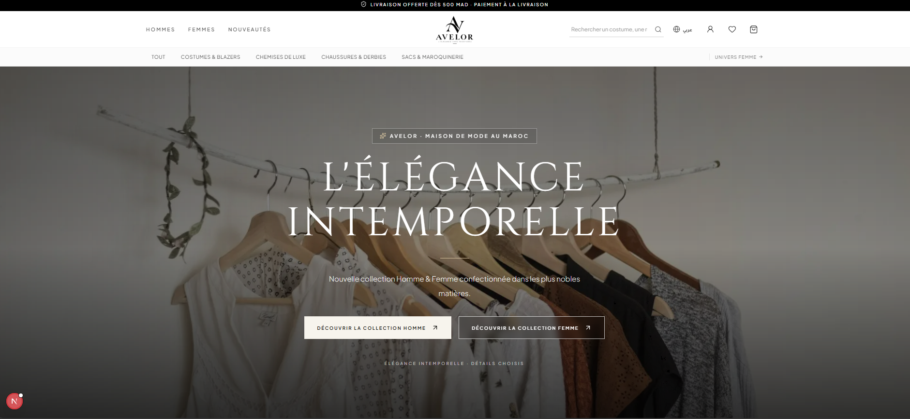

# AVELOR — Maison de Haute Couture & Prêt-à-Porter de Luxe

<p align="center">
  
</p>

<p align="center">
  <strong>L'élégance sans frontières · دار الأزياء الفاخرة بالمغرب</strong><br>
  Plateforme e-commerce omnicanale haut de gamme dédiée à la mode masculine et féminine au Maroc.
</p>

<p align="center">
  
  
  
  
  
  
  
  
</p>


<p align="center">
  
</p>
---

## 📖 Sommaire

1. [Présentation du Projet](#-présentation-du-projet)
2. [Points Forts & Fonctionnalités](#-points-forts--fonctionnalités)
3. [Stack Technologique & Architecture](#-stack-technologique--architecture)
4. [Identifiants de Démonstration & Codes Promo](#-identifiants-de-démonstration--codes-promo)
5. [Démarrage Rapide](#-démarrage-rapide)
   - [Lancement en 1 Clic (Windows)](#1-lancement-en-1-clic-windows)
   - [Démarrage Manuel (Backend + Frontend)](#2-démarrage-manuel)
   - [Démarrage via Docker Compose](#3-démarrage-via-docker-compose)
6. [Variables d'Environnement](#-variables-denvironnement)
7. [Documentation API REST](#-documentation-api-rest)
8. [Arborescence du Projet](#-arborescence-du-projet)
9. [Sécurité & Bonnes Pratiques](#-sécurité--bonnes-pratiques)

---

## 💎 Présentation du Projet

**AVELOR** est une plateforme e-commerce luxueuse conçue sur-mesure pour le marché marocain, alliant les codes de la haute couture internationale (minimalisme, typographie d'art, fluidité absolue) aux spécificités du commerce électronique local (MAD, paiement à la livraison, livraison express dans tout le Royaume, bilinguisme intégral français/arabe).

L'application associe un **Frontend Next.js 16 (App Router)** ultra-rapide et responsive à une **API Backend Python FastAPI** robuste, sécurisée et connectée à une base de données relationnelle **PostgreSQL (Supabase)**.

---

## ✨ Points Forts & Fonctionnalités

### 🏛️ Expérience Client & Design Haute Couture
- **Deux Univers Dédiés** :
  - **Univers Homme (`/homme`)** : Costumes sartoriaux, chemises en coton d'Égypte, mocassins patinés, sacs de voyage 48h.
  - **Univers Femme (`/femme`)** : Robes sculpturales en soie, blazers structurés, sacs à main en cuir grainé, souliers et maroquinerie.
- **Bilingue & Support RTL Intégral** :
  - Basculement instantané Français (`LTR`) / Arabe (`RTL`).
  - Typographie adaptée : *Cinzel* & *Plus Jakarta Sans* (FR) et *Tajawal* (AR).
- **Navigation Zéro Secousse (CLS = 0)** :
  - Header sticky haute performance avec découplage du bandeau d'annonce.
  - Mécanisme anti-vibration avec hystérésis au scroll et synchronisation 60fps via `requestAnimationFrame`.
  - Méga-menu catalogue interactif avec navigation par catégories et mise en avant éditoriale.
- **Micro-Animations Framer Motion** :
  - Animations de transition de pages fluides, entrées en cascade (stagger) et feedbacks visuels subtils.
- **Mini-Panier Coulissant (MiniCart)** :
  - Slide-over temps réel avec calcul instantané du sous-total.
  - Barre de progression de livraison offerte (gratuite dès 500 MAD d'achat).
- **Tunnel de Commande (Checkout)** :
  - Processus optimisé en 3 étapes (Coordonnées, Livraison, Paiement).
  - Validation automatique des numéros de téléphone et adresses au Maroc.
  - Paiement à la livraison (**Cash on Delivery — COD**) avec traçabilité complète.

### 🛡️ Espace d'Administration Avancé (`/admin`)
- **Tableau de Bord KPI en Temps Réel** :
  - Chiffre d'affaires total (MAD), nombre de commandes, panier moyen, alertes de stock critique.
- **Gestion Complète des Commandes** :
  - Filtres multi-critères par statut (`PENDING`, `CONFIRMED`, `PROCESSING`, `SHIPPED`, `DELIVERED`, `CANCELLED`).
  - Changement de statut avec génération de numéro de suivi transporteur.
  - Annulation sécurisée avec **restitution automatique des stocks**.
- **Gestion du Catalogue & des Variantes** :
  - Création et modification de produits (prix de base, prix promotionnel, univers, descriptions bilingues).
  - Gestion des variantes : tailles, pastilles de couleur visuelles, SKU unique, stock en temps réel.
  - Décrémentation transactionnelle des stocks et traçabilité des mouvements d'inventaire (`InventoryMovement`).
- **Gestion des Promotions & Coupons** :
  - Création de codes de réduction en pourcentage (%) ou en montant fixe (MAD).
  - Suivi des limites d'utilisation, dates de validité et montants minimaux d'achat.

### 🔐 Authentification & Sécurité
- **Authentification Hybride** :
  - Comptes locaux : JSON Web Tokens (JWT) chiffrés avec mots de passe hashés par `bcrypt`.
  - Social Login : Intégration Supabase OAuth (Google, Apple, etc.) avec synchronisation automatique des profils.
- **Sécurité API** :
  - Rate Limiting adaptatif via `slowapi` pour contrer les attaques par force brute.
  - Protection CORS stricte.
  - Transactions de base de données ACID gérées via SQLAlchemy 2.0.

---

## 🛠️ Stack Technologique & Architecture

| Couche | Technologies |
| :--- | :--- |
| **Frontend** | Next.js 16 (App Router), React 19, TypeScript 5, Tailwind CSS v4, Framer Motion, Lucide Icons |
| **Backend** | Python 3.10+, FastAPI, SQLAlchemy 2.0, Pydantic v2, Uvicorn, SlowAPI, Psycopg2-binary |
| **Base de Données** | PostgreSQL (Supabase Connection Pooler IPv4 & SSL) / SQLite fallback |
| **Auth** | JWT (PyJWT), Passlib / Bcrypt, Supabase Auth JS SDK |
| **DevOps / Outils** | Docker, Docker Compose, PostCSS, ESLint |

---

## 🔑 Identifiants de Démonstration & Codes Promo

Les données de démonstration sont injectées automatiquement lors du premier démarrage (`app/db/seed.py`).

### 👤 Comptes de Test

| Rôle | Email | Mot de passe | Accès |
| :--- | :--- | :--- | :--- |
| **Administrateur** | `admin@avelor.ma` | `AdminAvelor2026!` | Accès complet à `/admin` |
| **Client Test** | `client@avelor.ma` | `ClientAvelor2026!` | Commandes, historique, profil |

### 🎟️ Codes Promotionnels Actifs

| Code | Type de réduction | Conditions |
| :--- | :--- | :--- |
| `BIENVENUE10` | **-10%** sur toute la commande | Dès 400 MAD d'achat |
| `AVELOR100` | **-100 MAD** de remise immédiate | Dès 1 200 MAD d'achat |

---

## 🚀 Démarrage Rapide

### 1. Lancement en 1 Clic (Windows)

Deux scripts exécutables sont fournis à la racine du projet :
1. Double-cliquez sur **`lancer-backend.bat`** (démarre l'API FastAPI sur le port `8000`).
2. Double-cliquez sur **`lancer-frontend.bat`** (démarre la boutique Next.js sur le port `3000`).
3. Ouvrez votre navigateur sur **[http://localhost:3000](http://localhost:3000)**.

---

### 2. Démarrage Manuel

#### Prérequis
- **Node.js** v18.17+ ou v20+
- **Python** 3.10+
- **Git**

#### Étape A : Initialisation du Backend (FastAPI)
```bash
# Se placer dans le dossier backend
cd backend

# Créer et activer l'environnement virtuel
python -m venv venv
# Sur Windows :
.\venv\Scripts\activate
# Sur Linux / macOS :
source venv/bin/activate

# Installer les dépendances
pip install -r requirements.txt

# Configurer l'environnement (si vous souhaitez brancher votre propre Supabase)
cp .env.example .env

# Lancer le serveur FastAPI
python -m uvicorn app.main:app --host 0.0.0.0 --port 8000 --reload
```
Le backend initialise et peuple automatiquement la base de données au démarrage (`seed.py`).
- API racine : `http://localhost:8000`
- Santé de l'API : `http://localhost:8000/health`
- Documentation Swagger interactive : `http://localhost:8000/api/v1/docs`

#### Étape B : Initialisation du Frontend (Next.js)
Dans un nouveau terminal :
```bash
# Se placer dans le dossier frontend
cd frontend

# Installer les paquets npm
npm install

# Lancer le serveur Next.js en mode développement
npm run dev
```
La boutique AVELOR est accessible sur **`http://localhost:3000`**.

---

### 3. Démarrage via Docker Compose

Pour déployer l'intégralité des services dans des conteneurs isolés :
```bash
docker-compose up --build
```

---

## ⚙️ Variables d'Environnement

Un fichier `.env.example` est présent dans `backend/.env.example` et à la racine :

```env
# Application
PROJECT_NAME="AVELOR Luxury Fashion"
API_V1_STR="/api/v1"

# Sécurité (générer avec: python -c "import secrets; print(secrets.token_hex(32))")
SECRET_KEY="votre-cle-secrete-aleatoire-a-remplacer-en-production"
ALGORITHM="HS256"
ACCESS_TOKEN_EXPIRE_MINUTES=10080

# Base de Données (Supabase PostgreSQL Pooler sur port 5432 ou 6543)
DATABASE_URL="postgresql+psycopg2://postgres.[REF]:[PASS]@[HOST]:5432/postgres?sslmode=require"

# Supabase Auth & Public Keys
NEXT_PUBLIC_SUPABASE_URL="https://[PROJECT_REF].supabase.co"
SUPABASE_ANON_KEY="votre_supabase_anon_key"
SUPABASE_SERVICE_ROLE_KEY="votre_supabase_service_role_key"

# Paramètres E-commerce Maroc
CURRENCY="MAD"
FREE_SHIPPING_THRESHOLD=500.0
STANDARD_SHIPPING_FEE=40.0
```

---

## 📡 Documentation API REST

FastAPI génère automatiquement une documentation OpenAPI interactive :
- **Swagger UI** : [http://localhost:8000/api/v1/docs](http://localhost:8000/api/v1/docs)
- **ReDoc** : [http://localhost:8000/api/v1/redoc](http://localhost:8000/api/v1/redoc)

### Principaux Endpoints :

| Méthode | Endpoint | Description |
| :--- | :--- | :--- |
| `POST` | `/api/v1/auth/login` | Connexion utilisateur & émission de token JWT |
| `POST` | `/api/v1/auth/register` | Inscription d'un nouveau client |
| `GET` | `/api/v1/products/` | Liste des produits (filtres par univers, catégorie, recherche) |
| `GET` | `/api/v1/products/{id_or_slug}` | Fiche produit détaillée avec variantes et stock |
| `POST` | `/api/v1/orders/` | Création d'une commande (décrémente les stocks atomiquement) |
| `POST` | `/api/v1/promotions/validate` | Validation et calcul d'un code promo |
| `GET` | `/api/v1/admin/dashboard` | Statistiques globales & KPIs financiers (Admin requis) |
| `PATCH` | `/api/v1/admin/orders/{id}/status` | Mise à jour du statut d'expédition (Admin requis) |
| `POST` | `/api/v1/admin/orders/{id}/cancel` | Annulation et réintégration immédiate des stocks |

---

## 📂 Arborescence du Projet

```text
AVELOR/
├── backend/
│   ├── app/
│   │   ├── api/v1/
│   │   │   ├── endpoints/       # Routes API (auth, products, orders, promotions, admin...)
│   │   │   └── api.py           # Registre du routeur v1
│   │   ├── core/                # Configuration, sécurité JWT/bcrypt, base de données
│   │   ├── db/seed.py           # Peuplement initial du catalogue et utilisateurs
│   │   ├── models/              # Modèles SQLAlchemy (User, Product, Order, Shipment...)
│   │   ├── schemas/             # Schémas de validation Pydantic v2
│   │   ├── services/            # Logique métier transactionnelle (OrderService...)
│   │   └── main.py              # Point d'entrée FastAPI & configuration CORS / Lifespan
│   ├── tests/                   # Tests automatisés pytest
│   ├── requirements.txt         # Dépendances Python
│   └── Dockerfile
├── frontend/
│   ├── src/
│   │   ├── app/                 # Next.js App Router (/, /homme, /femme, /checkout, /admin...)
│   │   ├── components/          # Composants UI (Header, Footer, MiniCart, ProductCard...)
│   │   ├── context/             # React Contexts (Language FR/AR RTL, Auth, Cart, Wishlist)
│   │   ├── lib/                 # Client API, Supabase SDK, dictionnaire de traductions
│   │   └── types/               # Définitions TypeScript globales
│   ├── public/                  # Assets statiques, logo officiel AVELOR
│   ├── package.json             # Dépendances Next.js & scripts npm
│   └── Dockerfile
├── lancer-backend.bat           # Script de démarrage rapide Backend (Windows)
├── lancer-frontend.bat          # Script de démarrage rapide Frontend (Windows)
├── docker-compose.yml           # Déploiement multi-conteneurs
└── README.md                    # Documentation officielle du projet
```

---

## 🔒 Sécurité & Bonnes Pratiques

- **Validation des Données** : Chaque payload entrant est validé par Pydantic v2 côté backend et TypeScript côté frontend.
- **Stock Décrémenté de Façon Atomique** : Évite les ventes excédentaires (overselling) grâce à des transactions de base de données ACID avec lock.
- **Zéro Rupture Visuelle (CLS = 0)** : Gestion du header sticky avec calcul d'hystérésis évitant toute vibration au scroll.
- **RGPD & Confidentialité** : Hashage irréversible des mots de passe en `bcrypt` avec salage automatique.
- **Architecture Modulaire** : Séparation stricte entre les couches de présentation, de logique métier et d'accès aux données.

---

<p align="center">
  <strong>© 2026 AVELOR Haute Couture. Tous droits réservés.</strong><br>
  Fait avec passion pour l'excellence de la mode au Maroc.
</p>
