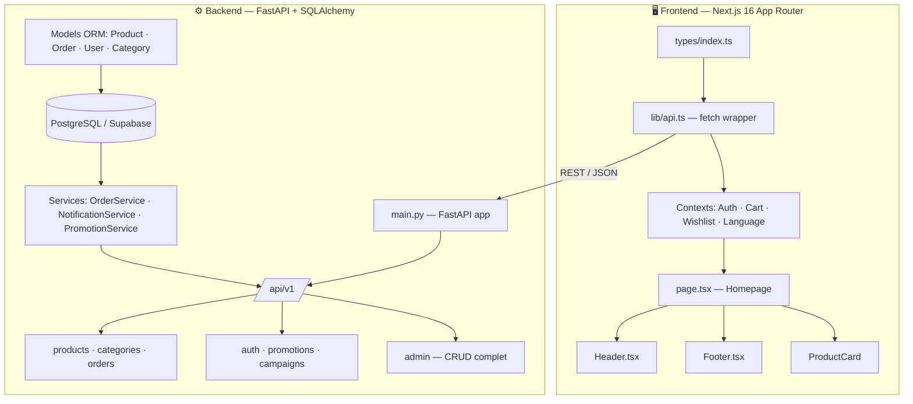

# 🏛️ AVELOR — Analyse Complète de la Plateforme

> Analyse réalisée le 25 octobre 2026 | Stack : Next.js 16 + FastAPI + PostgreSQL

---

## 1. Vue d'Ensemble Architecturale



---

## 2. Analyse par Couche

### 2.1 🗃️ Modèle de Données (Backend)

**Points forts ✅**
| Entité | Qualité |
|--------|---------|
| `Product` | SKU unique, slug indexé, bilingue FR/AR, `discount_price` séparé — propre |
| `ProductVariant` | Taille + couleur (nom FR/AR + code hex) + stock — complet |
| `InventoryMovement` | Journal des mouvements avec raison (SALE/RESTOCK/RETURN/ADJUSTMENT) — excellent |
| `Order` | Snapshot des données achat, guest checkout supporté (`user_id` nullable) — production-ready |
| `OrderItem` | Snapshot produit/prix au moment de l'achat — correct pour éviter les dérives de prix |
| `Shipment` / `Payment` | Entités séparées, extensibles — architecture saine |
| `CouponRedemption` | Traçabilité des coupons par commande et utilisateur — rigoureux |

**Problèmes identifiés ⚠️**
- `addresses` table existe dans `schema.sql` mais **non utilisée** dans les commandes (adresse stockée en champ texte brut sur `Order`) → duplication potentielle, pas de réutilisation
- `hashed_password` non nullable : bloque les OAuth-only users (Google/GitHub sans mot de passe)
- `Payment.provider_payload` est un `Text` non structuré → difficile à requêter pour les webhooks
- Pas de **soft delete** sur les produits (seulement `is_active`)
- Pas de champ `tags` ou `material` pour enrichir le SEO produit

---

### 2.2 ⚙️ Backend — FastAPI

**Points forts ✅**
- Architecture en couches claire : `api/v1/endpoints` → `services` → `models`
- Rate limiting avec `slowapi` ✓
- CORS configuré proprement ✓
- JWT + bcrypt via `passlib` ✓
- `OrderService.create_order` est transactionnel avec rollback implicite — robuste
- `NotificationService` avec formatage WhatsApp/SMS — adapté au marché marocain
- `PromotionService` avec validation de coupon isolée
- Lifespan hook pour init DB au démarrage ✓

**Problèmes identifiés ⚠️**

| Problème | Criticité | Localisation |
|----------|-----------|--------------|
| `SECRET_KEY` en dur dans `config.py` (même avec .env, la valeur par défaut est exposée dans le code) | 🔴 Sécurité critique | `core/config.py:14` |
| `FIRST_SUPERUSER_PASSWORD` hardcodée dans le code source | 🔴 Sécurité critique | `core/config.py:36` |
| Token JWT expire en **7 jours** sans refresh token | 🟡 Sécurité | `config.py:16` |
| `asyncpg` dans requirements mais backend 100% synchrone SQLAlchemy | 🟡 Incohérence | `requirements.txt:8` |
| `admin.py` endpoint unique de 27KB — dieu-objet | 🟡 Maintenabilité | `endpoints/admin.py` |
| Pas de **pagination** sur tous les endpoints admin | 🟡 Performance | `admin.py` |
| Pas de **cache** (Redis/in-memory) sur les produits/catégories | 🟡 Performance | — |
| Pas de **validation d'images** (URL uniquement, pas d'upload) | 🟠 Fonctionnel | — |
| `slowapi` limiter non configuré avec des règles spécifiques par route | 🟡 Sécurité | `core/limiter.py` |
| Alembic présent dans requirements mais **aucune migration** présente | 🟡 Déploiement | — |

---

### 2.3 🎨 Frontend — Next.js 16

**Points forts ✅**
- Fonts premium : `Cinzel` (serif luxury) + `Plus Jakarta Sans` + `Tajawal` (arabe) ✓
- Animations Framer Motion soignées (fade, scale, stagger) ✓
- Support RTL/arabe natif via `dir` dynamique ✓
- SEO : metadata complète (OG, Twitter, canonical) ✓
- `mock-data` pour le rendu initial (avant API) → bonne UX ✓
- Palette de couleurs luxe cohérente (`#faf9f6`, `#191916`, `#d8c5a0`) ✓
- Design token Tailwind v4 dans `globals.css` → maintenable ✓
- Skip link accessibilité (`#main-content`) ✓
- `prefers-reduced-motion` respecté ✓
- `scrollbar-gutter: stable` → évite le layout shift ✓
- Cart + Wishlist + Auth en Context global ✓

**Problèmes identifiés ⚠️**

| Problème | Criticité | Localisation |
|----------|-----------|--------------|
| `Header.tsx` = 1187 lignes — composant monolithique | 🔴 Maintenabilité | `Header.tsx` |
| Token JWT stocké dans `localStorage` (XSS vulnérable) | 🔴 Sécurité | `AuthContext.tsx:29` |
| `api.ts` utilise `any` massivement — pas de type safety | 🟡 Qualité | `lib/api.ts` |
| `search/page.tsx` : texte hardcodé en français ("Résultats de recherche") | 🟡 i18n | `search/page.tsx:36` |
| `page.tsx` coupon code non feedback visuel de copie | 🟠 UX | `page.tsx:316-326` |
| Pas de **loading skeleton** sur la page search | 🟠 UX | `search/page.tsx` |
| Images : URL Unsplash en dur → dépendance externe, CDN non maîtrisé | 🟡 Production | `page.tsx:65` |
| Pas de **error boundary** global React | 🟡 Robustesse | — |
| `ui/` components : seulement `motion.tsx` (composants UI custom absents) | 🟠 Architecture | `components/ui/` |
| `useLanguage` importé dans chaque composant sans selector → re-render excessif | 🟡 Performance | multiple |

---

### 2.4 🔒 Sécurité

| Risque | Niveau | Détail |
|--------|--------|--------|
| JWT dans localStorage | 🔴 CRITIQUE | Vulnérable au XSS. Migrer vers `httpOnly cookie` |
| Secret key exposée dans le code source | 🔴 CRITIQUE | `.env` non chargé = secret par défaut en production |
| Admin password hardcodé | 🔴 CRITIQUE | `AdminAvelor2026!` visible dans le code |
| CORS `allow_methods=["*"]` | 🟡 | Trop permissif, restreindre aux méthodes nécessaires |
| Pas de CSRF protection | 🟡 | Nécessaire si cookies httpOnly sont utilisés |
| Rate limiting global uniquement | 🟡 | Login brute-force non spécifiquement limité |
| `provider_payload` stocké en texte (pas chiffré) | 🟡 | Données sensibles paiement |

---

### 2.5 📐 Design & UX

**Points forts ✅**
- Identité visuelle forte et cohérente (gold `#d8c5a0`, ivory `#faf9f6`, dark `#191916`)
- Typographie Cinzel excellente pour le luxe
- Hero section impactante avec parallax image + animations
- Sections bien structurées : Hero → Benefits bar → Collections → Produits vedettes → Promo
- Micro-animations de qualité (hover sur collection cards)
- Promo section avec code copyable — bonne idée UX

**Opportunités d'amélioration UX/Design**
- ❌ Pas de **section "Notre Histoire"** / About — manque d'âme de marque
- ❌ Pas de **Lookbook** / éditorial lifestyle
- ❌ Pas de **témoignages clients** (avis, étoiles)
- ❌ **Countdown timer** absent sur les promotions
- ❌ Pas de **quick view** produit au survol
- ❌ Pas de **recently viewed** produits
- ❌ Panier **mini-cart** (MiniCart.tsx existe mais non visible dans l'analyse de la page accueil)
- ❌ Pas de **newsletter** / email capture section
- ❌ Pas de **sticky "Ajouter au panier"** sur mobile
- ❌ Breadcrumbs absents sur les pages produit/catégorie

---

## 3. Améliorations Prioritaires pour Rendre la Plateforme Premium

### 🔴 URGENTES (Sécurité)

```diff
# 1. Remplacer localStorage par httpOnly cookie
- const savedToken = localStorage.getItem("avelor_token")
+ // Utiliser httpOnly cookie via middleware Next.js + Set-Cookie backend

# 2. Variables d'environnement strictes
- SECRET_KEY: str = "avelor-luxury-fashion-maroc-super-secret-key-..."
+ SECRET_KEY: str  # Aucune valeur par défaut → crash au démarrage si absente

# 3. Séparer admin password de la config
- FIRST_SUPERUSER_PASSWORD: str = "AdminAvelor2026!"
+ FIRST_SUPERUSER_PASSWORD: str  # Obligatoire via .env
```

### 🟡 ARCHITECTURE

1. **Découper `Header.tsx`** en sous-composants : `NavDesktop`, `NavMobile`, `MegaMenu`, `SearchOverlay`, `UserMenu`
2. **Découper `admin.py`** en modules : `admin_products.py`, `admin_orders.py`, `admin_customers.py`
3. **Typer `api.ts`** avec les interfaces TypeScript correctes (utiliser `types/index.ts`)
4. **Ajouter Alembic migrations** pour versioning de schéma propre
5. **Ajouter Redis** pour cache des produits/catégories (TTL 5 min)

### 🟢 PREMIUM FEATURES À AJOUTER

#### Design & UX
| Feature | Impact | Effort |
|---------|--------|--------|
| **Quick View modal** produit au hover | ⭐⭐⭐ Très élevé | Moyen |
| **Zoom image** produit (pinch/scroll) | ⭐⭐⭐ Très élevé | Faible |
| **Lookbook / Editorial** section homepage | ⭐⭐⭐ Très élevé | Moyen |
| **Avis clients** avec étoiles | ⭐⭐⭐ Très élevé | Élevé |
| **Countdown promo** animé | ⭐⭐ Élevé | Faible |
| **Newsletter section** (email capture) | ⭐⭐ Élevé | Faible |
| **Recently viewed** products bar | ⭐⭐ Élevé | Faible |
| **Toast notifications** (ajout panier, wishlist) | ⭐⭐⭐ Critique UX | Faible |
| **Breadcrumbs** navigables | ⭐⭐ Élevé | Faible |
| **Sticky CTA mobile** "Ajouter au panier" | ⭐⭐⭐ Critique mobile | Faible |
| **Filtres visuels** (couleur, taille) sur listing | ⭐⭐⭐ Très élevé | Moyen |
| **Section "Notre Maison"** / About brand | ⭐⭐ Élevé | Moyen |
| **Cursor personnalisé** (luxury brands effect) | ⭐ Prestige | Faible |
| **Page 404 branded** | ⭐⭐ Élevé | Faible |

#### E-commerce & Business
| Feature | Impact | Effort |
|---------|--------|--------|
| **Paiement en ligne** (CMI Maroc) intégration réelle | ⭐⭐⭐ Critique | Élevé |
| **Wishlist partageable** (link share) | ⭐⭐ Élevé | Moyen |
| **Comparateur** 2-3 produits | ⭐⭐ Élevé | Moyen |
| **Stock low alert** ("Plus que 2 en stock") | ⭐⭐⭐ Très élevé | Faible |
| **Produits complémentaires** (cross-sell) | ⭐⭐⭐ Très élevé | Moyen |
| **Programme fidélité** (points/récompenses) | ⭐⭐ Élevé | Élevé |
| **Multi-images** avec carrousel produit | ⭐⭐⭐ Très élevé | Moyen |
| **Guide des tailles** popup | ⭐⭐⭐ Très élevé | Faible |
| **Retours & échanges** formulaire | ⭐⭐ Élevé | Moyen |

#### Performance & SEO
| Amélioration | Impact | Effort |
|--------------|--------|--------|
| **Next.js Image optimization** (remplacer Unsplash bruts) | ⭐⭐⭐ | Faible |
| **Structured Data** (Schema.org Product/BreadcrumbList) | ⭐⭐⭐ SEO | Moyen |
| **ISR** (Incremental Static Regen) pour pages catégories | ⭐⭐⭐ | Moyen |
| **Cache Redis** backend produits | ⭐⭐⭐ | Moyen |
| **Lazy loading** sections homepage | ⭐⭐ | Faible |
| **sitemap.xml** dynamique | ⭐⭐⭐ SEO | Faible |
| **robots.txt** configuré | ⭐⭐ SEO | Faible |

---

## 4. Score Global

| Dimension | Score | Commentaire |
|-----------|-------|-------------|
| **Architecture Backend** | 7.5/10 | Bonne structure, quelques god objects |
| **Architecture Frontend** | 6.5/10 | Header monolithique, manque de composants |
| **Sécurité** | 4/10 | JWT localStorage + secrets hardcodés = bloquant |
| **Design & UX** | 8/10 | Identité luxe très réussie, quelques features manquantes |
| **Performance** | 6/10 | Pas de cache, images non optimisées |
| **i18n / Accessibilité** | 8.5/10 | RTL + skip link + motion preferences = excellent |
| **Fonctionnalités E-com** | 7/10 | Bon noyau, pas de paiement online réel, manque quick view |
| **SEO** | 7/10 | Metadata OK, Schema.org absent, sitemap manquant |
| **Qualité du Code** | 7/10 | Bien structuré, `any` trop utilisé en TS |

### **Score Global : 7/10** — Très bonne base, urgent de corriger la sécurité et d'enrichir l'UX pour atteindre le niveau premium attendu.

---

## 5. Roadmap Recommandée

```
Phase 1 — Sécurité (1 semaine) 🔴
├── Migrer JWT vers httpOnly cookie
├── Supprimer les secrets du code source
└── Rate limiting sur /auth/login

Phase 2 — Qualité Code (2 semaines) 🟡
├── Découper Header.tsx en sous-composants
├── Typer api.ts avec les interfaces correctes
├── Ajouter error boundary React
└── Ajouter migrations Alembic

Phase 3 — UX Premium (3 semaines) 🟢
├── Toast notifications (Sonner / custom)
├── Quick View modal produit
├── Zoom image produit
├── Guide des tailles popup
├── Countdown timer promotions
├── Stock low alert badge
└── Sticky mobile CTA

Phase 4 — Features Business (4 semaines) ⭐
├── Section avis clients
├── Newsletter email capture
├── Lookbook / éditorial
├── Intégration CMI (paiement en ligne réel)
└── Programme fidélité

Phase 5 — Performance & SEO (2 semaines) 📈
├── Redis cache backend
├── ISR Next.js pages catalogue
├── Schema.org structured data
├── sitemap.xml + robots.txt
└── Optimisation images (Cloudinary / Supabase Storage)
```

---

*Analyse générée par Antigravity IDE — AVELOR Platform v1.0.0*
